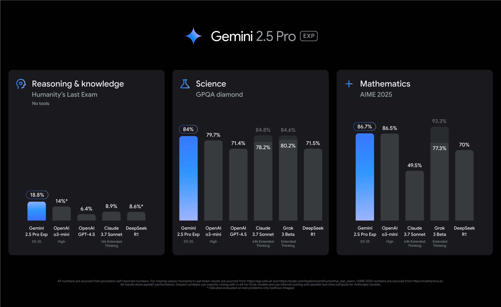
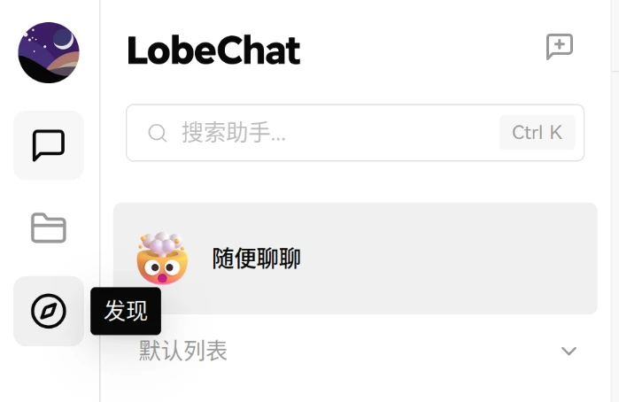
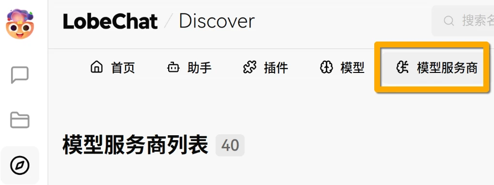
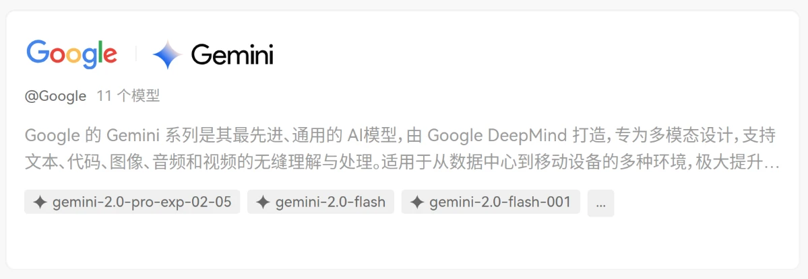
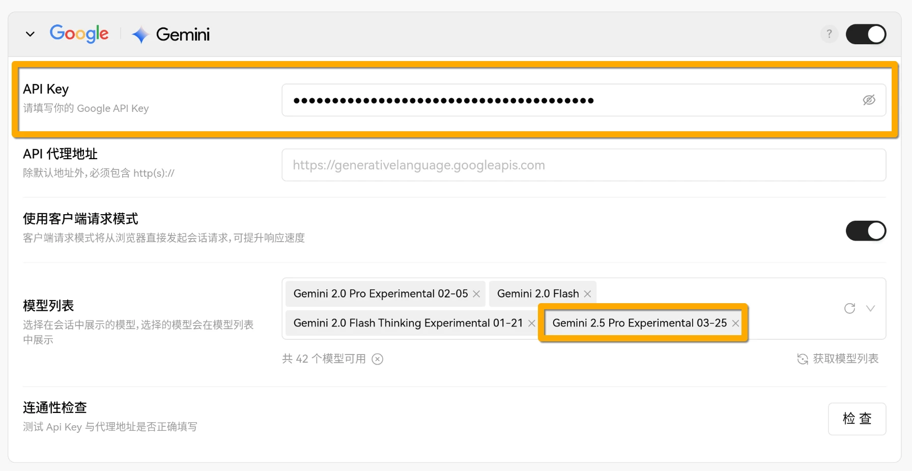
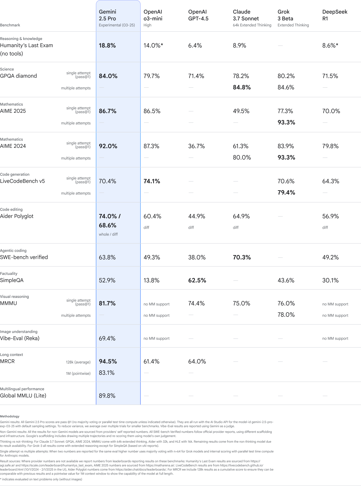
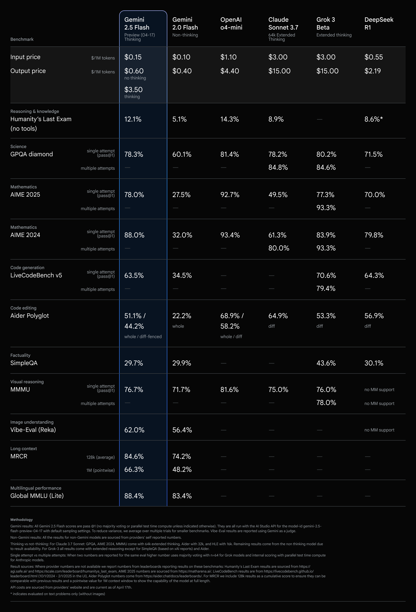

## 前言

Gemini 2.5 Pro是Google最新（截至2025.03.29）推出的一款强大的推理模型，在多项测试中表现优异。

|[](/img/llm/final_2.5_blog_1.original.webp)|
|:----:|
|Google Gemini 2.5 Pro与其他模型测试结果对比|

目前，Gemini 2.5 Pro的API已经**免费**开放使用，但是Gemini的网页端尚未集成这一新的模型。因此，如果我们想要使用Gemini 2.5 Pro，就需要借助API来实现。

## 安装LobeChat Docker

LobeChat是一个开源的高性能聊天机器人框架，支持多种模型的接入和使用。网页版的LobeChat需要付费才能使用自己的API密钥，而自己部署的LobeChat则可以免费使用。

如果没有安装Docker，请参考[Docker安装教程](https://www.docker.com/get-started)或者[Arch Wiki](https://wiki.archlinux.org/title/Docker)进行安装和配置。

在安装好Docker后，打开终端，输入以下命令来首次运行LobeChat：

```bash
docker run -d -p 3210:3210 --name lobe-chat lobehub/lobe-chat:latest
```

如果你已经安装过LobeChat，可以使用以下命令来运行：

```bash
docker start lobe-chat
```

## 在LobeChat中配置

首先，访问[Gemini的API页面](https://aistudio.google.com/app/apikey)并登录Google账号，点击`创建API密钥`。请注意，API密钥是非常重要的凭证，请不要泄露。

然后打开浏览器，访问LobeChat页面（比如`127.0.0.1:3210`，端口是前面`-p 3210:3210`处配置的）。点击页面左侧的`发现`：

[](/img/llm/lobechat-discover.webp)

随后点击上部的`模型服务商`：

[](/img/llm/lobechat-providers.webp)


找到Google Gemini：

[](/img/llm/lobechat-provider-google-gemini.webp)

点击右侧的`配置服务商`，启用Google Gemini，并在API Key处填写之前获取的API密钥；同时，在`模型列表`中添加`Gemini 2.5 Pro`：

[](/img/llm/lobechat-gemini-config.webp)

随后，可以点击`连通性检查`来测试API是否可用。

如果测试成功，即可回到LobeChat的主页面，点击左侧的`聊天`，选择`Google Gemini 2.5 Pro`模型并使用。

## 缺点

这样LobeChat的简单客户端部署方式不支持上传图片以外的文件，因此不能使用Gemini 2.5 Pro阅读文献、代码等。LobeChat只有在服务端数据库部署的时候才支持上传其他文件，而这样的部署方式较为麻烦。

## 补充

Gemini 2.5 Pro的API目前使用频率限制为5 RPM，即每分钟最多5次请求，这可能不能适用于翻译等高频率的场景，但是对于复杂问题，模型的推理时间可能本来就比较久，因此5 RPM的限制基本上不会影响使用。
* Google缩紧了API的使用限制，免费版Gemini 2.5 Pro目前每日调用次数限制为25次，每分钟限制为5次，每分钟Token数限制为250000。

笔者发现目前Gemini 2.5 Pro已经可以在[**Google AI Studio**](https://aistudio.google.com/)中直接免费使用了，而且支持了**上传文件**的功能。（甚至支持指定YouTube上的视频作为输入）😂😂😂可以直接在Google AI Studio中使用Gemini 2.5 Pro进行文献阅读、代码分析等操作。

此外，[OpenRouter AI](https://openrouter.ai)也支持了Gemini 2.5 Pro，注册账号以后即可直接使用，但是对文件上传大小限制较严格，仅支持10 MiB以下的文件上传。
* 更新：OpenRouter AI的Gemini 2.5 Pro增加了限制，要求**累计充值量达到$10**才能使用免费版，否则只能使用按照Token数量的计费版。
* OpenRouter目前提供的Gemini 2.5 Pro较为拥挤，稳定性较低，可能出现无回应、回答中断等问题。
* 目前Google发布了Gemini 2.5 Flash，免费版每日限制为500次请求，每分钟限制为10次请求，每分钟Token数限制为250000，性能也非常不错，但是免费版额度比Gemini 2.5 Pro要高得多，推荐使用。

|[](/img/llm/gemini_benchmarks_cropped_light2x_1PPmDuP.webp)|[](/img/llm/gemini_2-5_flashcomp_benchmarks_dark2x.original-lossless.webp)|
|:----:|:----:|
|Google Gemini 2.5 Pro与其他模型测试结果对比|Google Gemini 2.5 Flash与其他模型测试结果对比|

* 2025.05.22，Google已经移除了免费的Gemini 2.5 Pro访问
* 在Gemini 2.5 Pro反向升级（2025.05.06）与Gemini 2.5 Flash升级（2025.05.20）之后，两者差距进一步缩小

| Benchmark / Capability              | Sub-category           | Gemini 2.5 Pro (Prev 05-06) | Gemini 2.5 Pro (Exp 03.25) | Gemini 2.5 Flash (Prev 05-20 Thinking) | Gemini 2.0 Flash | OpenAI o4-mini | OpenAI o3 | OpenAI GPT-4.1 | Claude 3.7 Sonnet (64K Ext.) | Grok 3 Beta (Ext.) | DeepSeek R1 |
| :---------------------------------- | :--------------------- | :-------------------------- | :------------------------- | :------------------------------------- | :--------------- | :------------- | :-------- | :------------- | :--------------------------- | :----------------- | :---------- |
| Input price                         | $/1M Tokens            | —                           | —                          | $0.15                                  | $0.10            | $1.10          | —         | —              | $3.00                        | $3.00              | $0.55       |
| Output price                        | $/1M Tokens            | —                           | —                          | $0.60                                  | $0.40            | $4.40          | —         | —              | $15.00                       | $15.00             | $2.19       |
| Reasoning & Knowledge               | Humanity's Last Exam (no tools) | 17.8%                       | 18.8%                      | 11.0%                                  | 5.1%             | 14.3%          | 20.3%     | 5.4%           | 8.9%                         | —                  | 8.6%*       |
| Science                             | GPQA diamond (single pass@1) | 83.0%                       | **84.0%**                  | 82.8%                                  | 60.1%            | 81.4%          | 83.3%     | 66.3%          | 78.2%                        | 80.2%              | 71.5%       |
|                                     | GPQA diamond (multiple)  | —                           | —                          | —                                      | —                | —              | —         | —              | —                            | **84.8%**          | —           |
| Mathematics                         | AIME 2025 (single pass@1) | 83.0%                       | 86.7%                      | 72.0%                                  | 27.5%            | **92.7%**      | 88.9%     | —              | 49.5%                        | 77.3%              | 70.0%       |
|                                     | AIME 2025 (multiple)   | —                           | —                          | —                                      | —                | —              | —         | —              | —                            | **93.3%**          | —           |
| Code generation                     | LiveCodeBench V5 (single pass@1) | **75.6%**                   | 70.4%                      | 63.9%                                  | 34.5%            | —              | —         | —              | —                            | 70.6%              | 64.3%       |
|                                     | LiveCodeBench V5 (multiple) | —                           | —                          | —                                      | —                | —              | —         | —              | —                            | **79.4%**          | —           |
| Code editing                        | Aider Polyglot (whole/diff) | 76.5%/72.7%                 | 74.0%/68.6%                | 61.9%/56.7%                            | 22.2%            | 68.9%/58.2%    | **81.3%/79.6%** | 51.6%/52.9%    | 64.9%                        | 53.3%              | 56.9% (diff only in Img1) |
| Agentic coding                      | SWE-bench verified         | 63.2%                       | 63.8%                      | 60.4%                                  | —                | 68.1%          | 69.1%     | 54.6%          | **70.3%**                    | —                  | 49.2%       |
| Factuality                          | SimpleQA                   | 50.8%                       | **52.9%**                  | 26.9%                                  | 29.9%            | —              | 49.4%     | 41.6%          | —                            | 43.6%              | 30.1%       |
| Factuality                          | FACTS grounding            | —                           | —                          | **85.3%**                              | 84.6%            | 62.1%          | —         | —              | 78.8%                        | 74.8%              | 56.8%       |
| Visual reasoning                    | MMMU (single pass@1)     | 79.6%                       | 81.7%                      | 79.7%                                  | 71.7%            | 81.6%          | **82.9%** | 75.0%          | 75.0%                        | 76.0%              | no MM sup.  |
|                                     | MMMU (multiple)          | —                           | —                          | —                                      | —                | —              | —         | —              | —                            | 78.0%              | no MM sup.  |
| Image understanding                 | Vibe-Eval (Reka)           | 65.6%                       | **69.4%**                  | 65.4%                                  | 56.4%            | —              | —         | —              | —                            | —                  | no MM sup.  |
| Video                               | Video-MME (Overall)        | **84.8%**                   | —                          | —                                      | —                | —              | —         | —              | —                            | —                  | no MM sup.  |
| Long Context                        | MRCR / MRCR v2 (128k avg)  | 93.0% (MRCR)                | **94.5%** (MRCR)           | 74.0% (v2)                             | 36.0% (v2)       | 49.0% (v2)     | —         | —              | —                            | 54.0% (v2)         | 45.0% (v2)  |
|                                     | MRCR / MRCR v2 (1M ptwise) | 82.9% (MRCR)                | 83.1% (MRCR)               | 32.0% (v2)                             | 6.0% (v2)        | —              | —         | —              | —                            | —                  | —           |
| Multilingual performance            | Global MMLU (Lite)         | 88.6%                       | **89.8%**                  | 88.4%                                  | 83.4%            | —              | —         | —              | —                            | —                  | —           |

由于LobeChat的灵活性限制，笔者目前更建议需要用API时参考使用笔者后面一篇博客推荐的[使用AIChat来调用Gemini 2.5 Pro](https://wszqkzqk.github.io/2025/03/30/config-and-use-aichat/)的方法。AIChat虽然界面没有LobeChat好看，但是可以更加方便灵活地实现各种功能。

对于Gemini 2.5 Pro在较多轮对话且上下文较长时不再先思考再回答的问题，可以尝试使用以下的提示词来引导模型：

```
Do not omit your thinking process. As the Gemini 2.5 pro model, you must first go through a thinking process before replying to me. **Please understand: In an environment like Google AI Studio, this thinking process of yours will be independently displayed through its interface features (e.g., the "Thoughts" experimental area), and this can be considered your "thinking window."**

After you have completed this thinking process, which is displayed by the AI Studio interface, you will generate the formal reply text. This text itself constitutes the content of the "reply window."

Therefore, please strictly adhere to the following key requirements:
1.  Your "thinking process" is to be displayed by AI Studio's "Thoughts" area.
2.  Your **final reply text (i.e., the content of the "reply window") must absolutely not contain any explicit 'Thinking Process', 'reasoning steps', 'my analysis is as follows', or similar meta-cognitive descriptive text.**

Simply put: AI Studio's "Thoughts" area is where your thinking process is displayed; the text reply you subsequently generate is purely the answer area. Do not repeat the thinking process in the answer area. This is what constitutes a correct reply.
```
