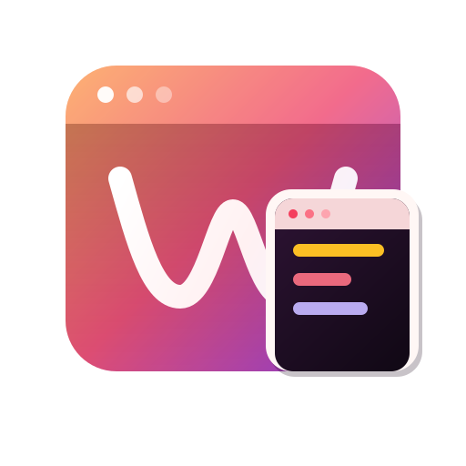
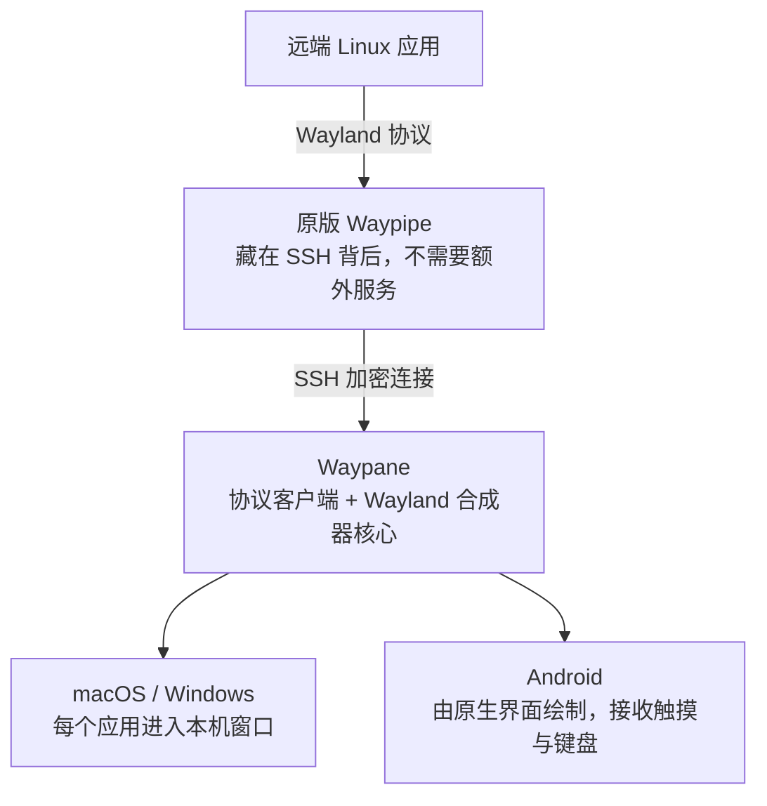
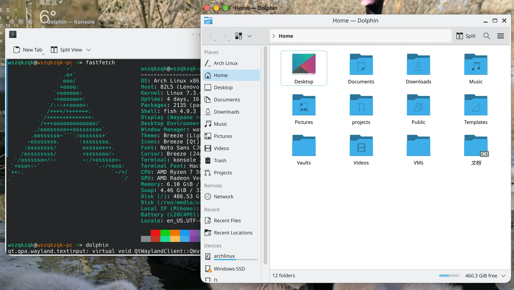
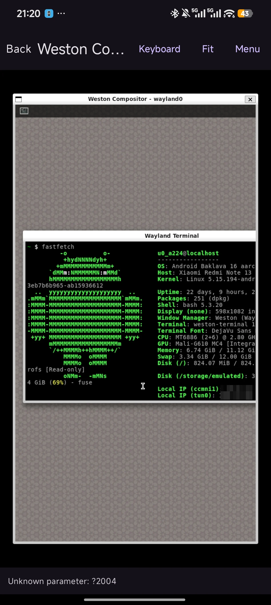
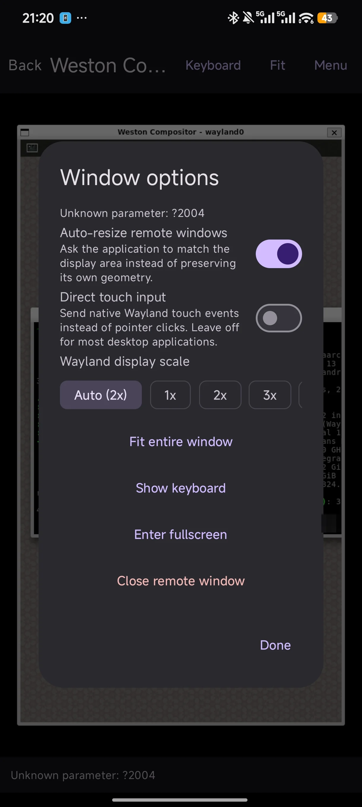
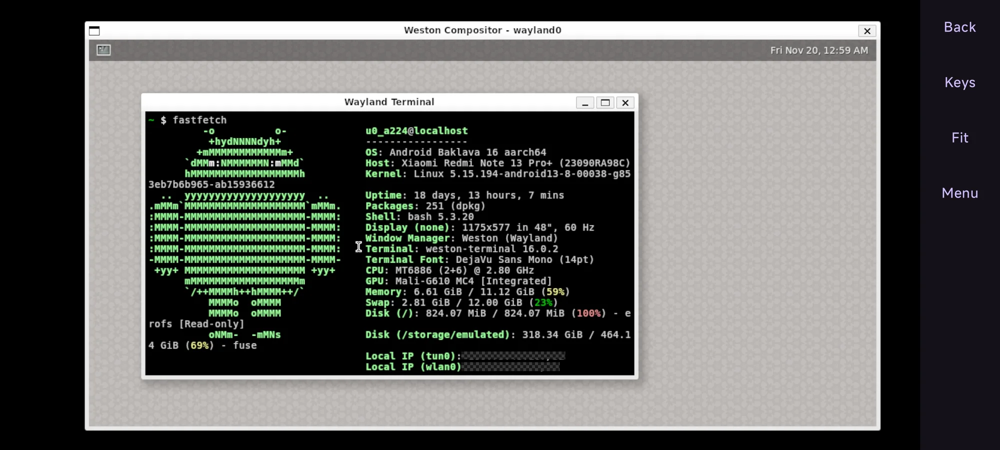

<h1 style="text-align: center;" aria-label="Waypane"><a href="https://github.com/wszqkzqk/waypane"></a></h1>

有时候，我们的代码和数据放在远程的 Linux 机器上，手边用的却是另一台设备。我们可能只是想看一张图有没有画对，用一下只在 Linux 上才有的图形工具，或者在路上接着处理昨晚没跑完的任务。这种时候，我们需要的只是那一个窗口，并不想引入更加复杂的远程桌面方案。

Waypipe 已经能把 Wayland 窗口送到另一台机器上，但接收的一端需要一套 Wayland 显示环境。Linux 桌面上现成就有，macOS、Windows 和 Android 却都没有，窗口送到这些系统上也不便直接显示。

为此，笔者开发了跨平台的 Wayland 合成器 **Waypane**。通过 SSH 连接远端的原版 [Waypipe](https://gitlab.freedesktop.org/mstoeckl/waypipe)，它直接把窗口画成 macOS 和 Windows 上的本机窗口，或者 Android 上的原生界面，不需要本机再准备显示环境。没有桌面的 Linux 服务器只需 SSH 和原版 Waypipe。手机既能打开另一台电脑上的窗口，也能 SSH 连回自身的 Termux，直接运行其中的 Wayland 程序。

## 窗口级转发如何工作

远程桌面几乎总能解决问题，但代价也很直接：多一个桌面、多一层窗口管理器，多一套缩放规则。手机横屏时要看整台电脑的桌面，本机的快捷键和另一套桌面互相抢，应用窗口被困在“桌面里的桌面”中。

Waypane 选择的是另一种粒度——窗口。



应用仍然在远端运行，文件、依赖和计算资源都在远端。来到手边的只是窗口、输入和剪贴板这些交互本身。Waypipe 负责把 Wayland 通信打包通过通道转发，Waypane 则在设备这一端充当 Wayland 合成器：接收缓冲区和事件，把窗口画出来，再把鼠标、触摸和键盘送回远端。

对使用者来说，最明显的变化是：**应用在哪里运行，与窗口在哪里显示，终于被分开了。**

## 远端只需要 SSH 和 Waypipe

很多用起来很有趣的软件，安装的前提条件比功能本身更让人退缩。要显示图形界面，远端似乎总得先有桌面环境、显示管理器、X server，或者一块 GPU。容器、云主机和集群节点往往恰好什么都不带。

Waypane 尽量避免把使用门槛堆在那一端：

- **远端只依赖标准件**：SSH 服务和原版 Waypipe，使用发行版或 Termux 的包管理器即可安装。
- **没有额外守护进程**：Waypane 通过 SSH 启动 Waypipe，退出时随之结束，不需要开放新的端口或维护后台服务。
- **不要求图形环境**：CPU 共享内存足以显示应用，不依赖远端正在运行的桌面、X server 或 GPU。
- **根据网络选择压缩**：默认使用 lz4；网络较慢时，可以切换为 zstd，来减少重复画面数据的传输量。
- **安全交给 SSH**：认证和加密沿用 SSH 本身；首次连接时核对并保存主机密钥指纹，保存的密钥发生变化时需要显式确认，不另设远程桌面服务。

这让本来只用来跑任务的机器，也能变成一个图形工作站的主机。

## 本机窗口与移动端交互

窗口级转发带来的好处，在于它可以按每个平台的窗口习惯去处理显示和输入。

在 macOS 和 Windows 上，远端的每个应用进入独立的本机窗口，拥有正常的边框、标题栏和关闭按钮，可以独立摆放、切换和调整大小。在 macOS 上，交互模式直接调用系统 OpenSSH：SSH 配置中的主机别名、ProxyJump 和 ssh-agent 都可以继续使用，不需要为工具再维护一份连接配置。

|[](/img/wayland/waypane-macos-native-windows.webp)|
|:----:|
|macOS 上通过 Waypane 连接 Arch Linux：在 Konsole 中直接启动 Dolphin，两者都是独立的本机窗口|

在 Android 上，Waypane 针对手持设备做了专门的交互设计：

- 根据屏幕密度选择自动缩放比例，也提供手动倍率和 Fit 适配。
- 支持缩放和平移，双指拖动充当滚动，长按相当于右键；需要精确操作时，可以直接发送触摸事件而不是鼠标模拟。
- 弹出的软键盘会把当前窗口推上去，但不会把应用挤成一团。
- 会话在切到其他应用后由前台服务保持，从后台回来时不必重新连接。
- 横屏时把操作入口放在侧边，把更多的空间留给窗口本身。
- 可以导入私钥或使用密码登录；导入的私钥保存在只有应用自己能访问的存储中，加密私钥支持口令解锁。

|[](/img/wayland/waypane-android-termux-session.webp)|[](/img/wayland/waypane-android-window-options.webp)|
|:----:|:----:|
|Waypane 中的 Termux 会话：操作栏可唤起键盘或 Fit 适配，下方提示来自远端 Weston 的输出|窗口选项：自动适配远端窗口、Direct touch、显示倍率，以及关闭当前远端窗口|

## 适用场景

### 在笔记本上开发远端项目

编辑器留在本机，数据处理和运行放在远程 Linux 上。当程序弹出图形窗口——可视化的图表、调试用的工具、某个只在 Linux 下提供的桌面程序——它直接以本机窗口出现。文件仍在远端，不必同步来同步去。

这种用法尤其适合没有显示器的云主机和虚拟机：为了偶尔看一眼窗口，不必往机器里塞进一整套桌面环境。

### 把手机或平板变成随身的工作站

Android 上安装 Waypipe 和 OpenSSH 最方便的途径是 [Termux](https://termux.dev/)。它可以运行在自己的手机上：一笔 SSH 连接连回本机，手机上就有一个可以触摸操作的 Linux 桌面。也可以用它连接家里的工作站，出门在外时打开需要的窗口接着处理。

Waypane 默认的连接配置就面向同一设备上的 Termux：地址填本机回环地址，端口是 Termux OpenSSH 默认监听的 8022。

### 给无头设备临时开一扇窗

调试 GUI 程序、给工具截图、检查自动化测试里的窗口行为，这些需求都可能很短。容器和集群节点通常只提供命令行，Waypane 可以在这类机器上临时显示窗口，查看完就关闭，不必为了短暂的需求长期维护图形环境。

### 关注 Wayland 协议本身

如果你关心远程图形传输如何工作，Waypane 也是一个小巧而完整的样本：如何解析穿过 SSH 通道的 Wayland 消息，如何处理被跨会话共享的文件描述符，如何在不同的平台上实现合成、呈现与输入回传。

## 工程设计：让协议保持可验证

Waypane 的可复用逻辑用 Rust 编写，并分为明确的几层：

- **协议客户端**实现 Waypipe 的线协议，处理协商、压缩以及共享内存和管道资源的复制。
- **共享核心**实现 Wayland 合成器状态和 xdg-shell 等协议，负责窗口、输入焦点、剪贴板和文本输入的生命周期。
- **平台层**负责各自擅长的事：桌面端在本机窗口中呈现；Android 端通过 JNI 接入原生渲染、触摸和前台服务，提供基于 Compose 的界面。

在上游 Waypipe 一侧，项目坚持**不依赖打过补丁的服务端**。仓库中保留一份只读的上游源码，作为协议参照和测试对端；CI 会与它运行互操作测试，覆盖真实 SSH 连接、主机密钥确认、共享内存复制、剪贴板、文本输入和窗口协议。上游发布新版本时，自动化任务会提醒更新测试基线。

这些测试把 Waypane 的表现与原版 Waypipe 逐一对应，让协议行为有可对照的标准。发布同样受这套检查约束：跨平台构建和测试通过后，标签会自动生成带正式签名的 Android APK、桌面二进制和 SHA-256 校验文件。

## 安装与使用

### Android 上连接

Android 手机的处理器、存储和电池足以承担许多日常 Linux 任务。Termux 不需要 root，就能在手机上提供一个带 `pkg` 包管理器的 Linux 用户空间，安装 OpenSSH、Clang、FFmpeg 等工具后，编译、脚本和后台服务都可以直接在手机上完成。笔者在[将 Android 手机打造为全功能的 ARM Linux 服务器](https://wszqkzqk.github.io/2026/10/18/Termux-Android-ARM-Server/)一文中介绍过这些用法。

Wayland 程序在 Termux 中也能运行，缺少的是一块能把它显示出来的屏幕。Waypane 补上这一块后，同一台手机既能充当 Linux 主机，也能直接显示其中的图形程序。

#### 准备本机 Termux

在 Android 手机的 Termux 中安装 OpenSSH、Waypipe 和一个用来显示的桌面：

```sh
pkg install openssh waypipe weston
sshd
whoami
passwd
```

记下 `whoami` 输出的用户名；`passwd` 用于设置登录密码。Weston 来自 `x11-repo`，如果 `pkg` 提示找不到软件包，先执行 `pkg install x11-repo` 再重试。

这种用法把同一台手机同时当作 Linux 主机和显示端：Termux 提供 Linux 环境和软件包，`sshd` 提供登录入口，Waypane 通过回环地址登录本机。Waypane 会自行选择 Termux 中可写的临时目录（如 `$PREFIX/tmp`），在其中放置 socket 并设置 `XDG_RUNTIME_DIR`，不需要手动配置环境变量。使用期间需要让 Termux 保持运行，系统的后台省电限制如果终止了 Termux，连接也会随之断开。

#### 连接 Waypane

从 [GitHub Releases](https://github.com/wszqkzqk/waypane/releases) 下载并安装 arm64 的 APK，需要 Android 8.0 或更高版本。连接另一台 Linux 电脑时，先按“准备 Linux 主机”一节配置好它的 SSH 和 Waypipe。

- 地址和端口：Termux 本机是 `127.0.0.1:8022`；其他机器填写它们的地址和 SSH 端口。
- 用户和认证：填写远端的用户名，选择密码或导入私钥。
- 命令：默认的 `weston` 会打开一个桌面，也可以填入单个应用，例如 `weston-terminal`。

点击连接，比对指纹并信任保存，远端窗口就会出现在手机里。

自己写的 Wayland 程序也一样使用：先在 Termux 中用 `pkg`、Clang 等工具安装依赖并编译，再把启动命令填入命令栏，它和手机上其他 Linux 程序一样运行，窗口由 Waypane 显示出来。命令栏允许参数，Waypipe 的选项由 Waypane 管理。

|[](/img/wayland/waypane-android-termux-desktop.webp)|
|:----:|
|同一台 Android 手机上，Waypane 通过 SSH 连接本机 Termux，显示其中的 Linux 桌面与应用窗口|

### macOS 或 Windows 上连接

#### 准备 Linux 主机

用发行版的包管理器安装 Waypipe，并确保 SSH 服务已启动。确认 OpenSSH 允许 SSH 的 Unix 套接字转发（`AllowStreamLocalForwarding yes`，这是 OpenSSH 的默认设置），然后准备好一个要显示的 Wayland 应用，例如 `foot`、`gtk4-demo` 或你自己的程序。

#### 运行桌面客户端

Releases 页面同时提供 macOS Apple Silicon 和 Windows x64 的二进制，并附有 SHA256SUMS。未经签名或公证的桌面程序可能触发 macOS Gatekeeper 或 Windows SmartScreen 的提示。macOS 用户也可以用 Rust 从仓库根目录自行构建桌面包：

```sh
cargo build --release --locked -p waypane-desktop
```

在 macOS 或其他类 Unix 系统上，不带子命令的交互方式最简单：

```sh
waypane-desktop --ssh user@linux-host
```

连接后会进入远端的登录 shell，直接运行 `weston-terminal`、`gtk4-demo` 或其他 Wayland 应用，每个应用都会作为独立窗口出现。

Windows 目前使用指定命令的方式：

```powershell
waypane-desktop.exe --ssh user@linux-host -- foot
```

这种显式命令模式使用内置的 Rust SSH 实现，不读取 `~/.ssh/config`；因此用户名要写在地址里，或者通过 `--user` 指定。macOS 上也支持这种方式，以便使用密码或加密私钥。

### 文件选择窗口不弹出的排查

许多应用通过 xdg-desktop-portal 打开文件选择窗口，由宿主的 portal 服务显示，这在 GTK、Qt 等工具包中都可能发生。如果服务器上已有的系统级 portal 服务没有可以连接的显示，点击按钮时可能毫无反应。

直接在会话总线上启动应用，让 portal 在与应用相同的显示环境里启动，就能解决这类情况：

```sh
dbus-run-session -- nautilus
```

## 参与贡献与反馈

Waypane 以 GPL-3.0-or-later 许可证开源（见仓库中的 [LICENSE](https://github.com/wszqkzqk/waypane/blob/main/LICENSE)）。如果你对其中任何一部分感兴趣，欢迎从一次真实使用开始：

- 项目：[wszqkzqk/waypane](https://github.com/wszqkzqk/waypane)
- 预构建包：[GitHub Releases](https://github.com/wszqkzqk/waypane/releases)
- 问题反馈：[GitHub Issues](https://github.com/wszqkzqk/waypane/issues)

各平台目前的限制和后续计划会持续更新。Windows 实机、不同发行版中的 Waypipe 版本，以及 GTK、Qt 等工具包的菜单、弹窗与文件对话框，是最值得测试也最容易发现问题的地方。如果遇到窗口不一样、点击对应不上或者连接意外结束，把触发步骤和 Waypane 保留下来的日志一起发到 Issues，会比一句“不能用”更容易让问题得到解决。
